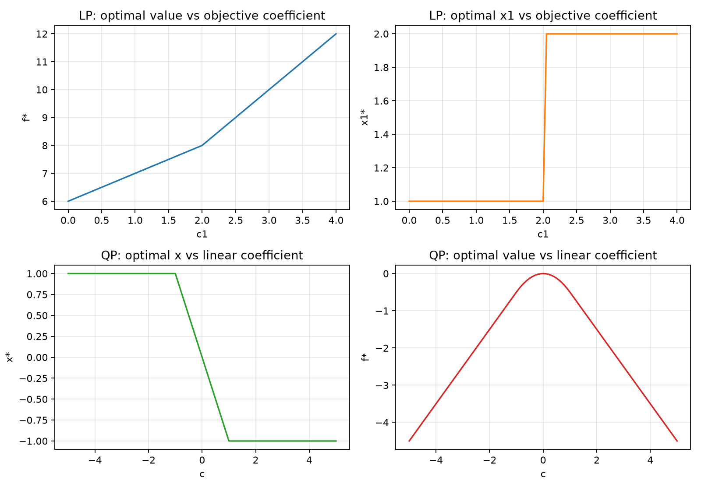
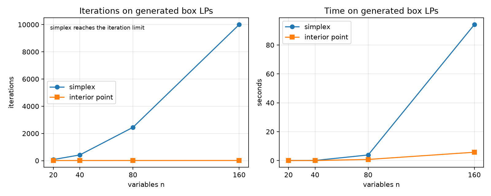

# opt-solver

[](https://github.com/IkerAbad/opt-solver/actions/workflows/ci.yml)
[](https://pypi.org/project/iker-opt-solver/)
[](https://www.python.org/downloads/release/python-3120/)
[](https://github.com/IkerAbad/opt-solver/blob/main/LICENSE)

Linear and convex quadratic optimization from scratch, with two methods per problem and an honest comparison against HiGHS.

- **Linear programming:** two-phase primal simplex with Bland's anti-cycling rule, and Mehrotra's predictor-corrector interior-point method with primal and dual phase I classification.
- **Convex quadratic programming:** primal active-set method for general linear constraints, and accelerated projected gradient for box constraints.
- **Input:** MPS and CPLEX LP readers.
- **Benchmark:** objective accuracy, iterations and wall-clock time against HiGHS on classic and generated instances.
- **Figures:** interior-point convergence, sensitivity to coefficients, and scaling.

The PyPI distribution is `iker-opt-solver` because `opt-solver` is already taken on PyPI. The import package is `opt_solver`.

```bash
pip install iker-opt-solver
```

## Why Python 3.12 + NumPy

The goal is to implement and compare algorithms, not to beat a production solver. Python keeps the algorithm visible, NumPy provides BLAS/LAPACK for the dense linear systems, and `highspy` puts the HiGHS reference in the same process. `pytest`, `ruff` and `mypy` cover the quality checks.

A C++/Eigen version would be faster, but it would move most of the effort into build systems and memory management, and the benchmark would still be dominated by HiGHS. The dense Python implementation is a deliberate limitation: it makes the algorithmic difference visible and the code auditable.

## Installation

From PyPI:

```bash
pip install iker-opt-solver
```

For development, from a clone:

```powershell
git clone https://github.com/IkerAbad/opt-solver.git
cd opt-solver
py -3.12 -m venv .venv
.\.venv\Scripts\Activate.ps1
python -m pip install --upgrade pip
pip install -e ".[dev,bench]"
```

On POSIX systems:

```bash
git clone https://github.com/IkerAbad/opt-solver.git
cd opt-solver
python3.12 -m venv .venv
source .venv/bin/activate
python -m pip install --upgrade pip
pip install -e ".[dev,bench]"
```

## Quick start

```python
import numpy as np

from opt_solver import LPProblem, solve_lp_ipm, solve_lp_simplex

problem = LPProblem(
    c=np.array([1.0, 1.0]),
    A=np.array([[1.0, 1.0]]),
    b=np.array([1.0]),
    row_sense=[">="],
    lb=np.zeros(2),
    ub=np.full(2, np.inf),
)

print(solve_lp_simplex(problem).objective)
print(solve_lp_ipm(problem).objective)
```

```python
from opt_solver import QPProblem, solve_qp_active_set

qp = QPProblem(
    Q=np.eye(2),
    c=np.array([-2.0, 1.0]),
    A=np.zeros((0, 2)),
    b=np.zeros(0),
    lb=np.zeros(2),
    ub=np.ones(2),
)

print(solve_qp_active_set(qp).x)
```

```python
from opt_solver import solve_lp_simplex
from opt_solver.problems import afiro

problem = afiro()
solution = solve_lp_simplex(problem)
print(solution.objective, solution.x)
```

## Methods

### Standard form

Every LP is converted to

```
minimize    cᵀ x
subject to  A x = b
            x >= 0
```

with `b >= 0`. Free variables are split into positive and negative parts, finite lower bounds are shifted, finite upper bounds become extra rows, and inequalities receive slack or surplus variables. The transformation stores `x_original = T x_standard + d`, so the solution is recovered without approximation. Phase I detects infeasibility. Phase II detects unboundedness when the entering column has no positive entry.

### Two-phase simplex with Bland's rule

Phase I adds one artificial variable per row and minimizes their sum. If the phase-I optimum is positive, the original problem is infeasible. Otherwise the artificial variables are pivoted out and phase II optimizes the real objective.

The entering variable is the smallest index with a negative reduced cost. On a ratio tie, the leaving variable is the one with the smallest basic index. This is Bland's rule, which rules out cycling and guarantees finite termination (Bland, 1977). The implementation uses a dense tableau and refactorizes the basis every 50 pivots to limit numerical drift. Bland's rule is robust but can be slow: its worst-case behaviour is exponential in the number of variables (Klee and Minty, 1972).

### Mehrotra predictor-corrector interior point

The main phase maintains positive primal and dual iterates `x`, `s` and a dual vector `y`, and solves the perturbed KKT system

```
A x = b
Aᵀ y + s = c
x_i s_i = μ
```

Each iteration forms `D = X S⁻¹`, solves `(A D Aᵀ) dy = rhs`, and computes the primal and dual directions. The predictor uses `r_cs = x ⊙ s`. The corrector adds the second-order term `dx ⊙ ds` and uses the adaptive centring parameter `σ = (μ_aff / μ)³` (Mehrotra, 1992). A fraction-to-boundary rule keeps `x` and `s` positive. The main phase stops when the primal residual, the dual residual and `μ` are below `1e-10`.

#### Infeasibility and unboundedness: phase I

The public solver classifies the problem before the main phase. The primal phase I minimizes `sum(a)` subject to `A x + a = b` with `x >= 0` and `a >= 0`. After row sign normalization, `b >= 0`, so the auxiliary problem is feasible and bounded below by zero. If its optimal artificial sum is above the phase tolerance, the primal is infeasible.

If the primal phase I is feasible, the dual phase I minimizes `sum(u)` subject to `Aᵀ (y+ - y-) + s - u = c` with `y+ >= 0`, `y- >= 0`, `s >= 0` and `u >= 0`. If its artificial sum is above the phase tolerance, the dual is infeasible. Since the primal is feasible, the primal is unbounded. If both phase I problems are feasible, the main predictor-corrector runs.

The phase tolerance is `max(1e-8, 10 * tol)`, which is `1e-8` with the default `tol = 1e-10`. The public solver returns `infeasible`, `unbounded`, `optimal` or `numerical_error`. For the first two, `x` is zero and the objective is `NaN`. The raw `mehrotra` helper still assumes a feasible and bounded standard-form problem, but it is only called after the phase I checks. The full algorithm, the choice over the homogeneous self-dual embedding, the phase I values and the comparison table with simplex and HiGHS are in [`docs/classification.md`](https://github.com/IkerAbad/opt-solver/blob/main/docs/classification.md).

### Convex QP: active set

The problem is

```
minimize    0.5 xᵀ Q x + cᵀ x
subject to  A x <= b
            lb <= x <= ub
```

A feasible starting point is obtained by solving a phase-I linear program with the simplex method. At each iteration the method solves the equality-constrained KKT system on the current working set. If the step is zero, it checks the multipliers and releases the constraint with the most negative multiplier. Otherwise it computes the first blocking constraint and adds it to the working set. The method terminates at a KKT point of the convex QP.

### Convex QP: projected gradient

For box constraints, the projection is exact:

```
x ← clip(y - (1/L) ∇f(y), lb, ub)
```

where `L = ||Q||₂`. The implementation uses FISTA (Beck and Teboulle, 2009) with adaptive restart and stops when the projected-gradient mapping is below tolerance. General linear rows are rejected: use the active-set method for those.

### MPS and LP readers

The MPS reader supports `NAME`, `OBJSENSE`, `OBJNAME`, `ROWS`, `COLUMNS`, `RHS`, `RANGES`, `BOUNDS` and `ENDATA`. The LP reader supports `Minimize`/`Maximize`, `Subject To`, `Bounds` and `End`. Objective constants are preserved. Integer, binary and semi-continuous variables are rejected because they are outside the project scope. The MPS reader handles free-format files and the common fixed-format layout, but not SOS, QMATRIX or indicator sections.

## Benchmark against HiGHS

Setup:

- HiGHS 1.16.0 through `highspy`, presolve disabled, primal/dual feasibility tolerances `1e-10`, IPM optimality tolerance `1e-10`.
- Our LP tolerance is `1e-10`. The QP tolerance is `1e-9`.
- The interior-point iteration count includes the primal and dual phase I. The main predictor-corrector phase alone uses 9 to 14 iterations on these problems.
- Acceptance criterion: absolute difference in the optimal objective value at most `1e-8`.
- Single run per solver, measuring only the solver call. Times are indicative.
- Machine: Windows 11, Ryzen 9 5900X, Python 3.12.10, NumPy 2.5.5.

All 36 runs in [`results/benchmark.md`](https://github.com/IkerAbad/opt-solver/blob/main/results/benchmark.md) satisfy the criterion. The largest absolute gap is `1.16e-9`. Selected results:

| Problem | Kind | Solver | Objective | Iterations | Time (s) | Gap |
|---|---|---|---:|---:|---:|---:|
| beale | LP | simplex | -0.05 | 6 | 0.000778 | 0.00e+00 |
| beale | LP | ipm | -0.04999999993 | 22 | 0.004352 | 6.52e-11 |
| AFIRO | LP | simplex | -464.7531429 | 51 | 0.003536 | 2.27e-13 |
| AFIRO | LP | ipm | -464.7531429 | 25 | 0.005963 | 8.16e-11 |
| gen_box_n40_m20_s40 | LP | simplex | -31.34596605 | 421 | 0.062994 | 1.78e-14 |
| gen_box_n40_m20_s40 | LP | ipm | -31.34596605 | 26 | 0.313796 | 1.79e-10 |
| gen_box_n80_m40_s80 | LP | simplex | -48.99257995 | 2448 | 7.440280 | 7.11e-15 |
| gen_box_n80_m40_s80 | LP | ipm | -48.99257995 | 27 | 3.802774 | 1.14e-09 |
| gen_eq_n80_m40_s1080 | LP | simplex | 96.63270498 | 407 | 0.053446 | 2.70e-12 |
| gen_eq_n80_m40_s1080 | LP | ipm | 96.63270498 | 25 | 0.011498 | 6.70e-10 |
| qp_box_n40_s40 | QP | active_set | -1824.453047 | 74 | 0.053316 | 3.70e-10 |
| qp_box_n40_s40 | QP | projected_gradient | -1824.453047 | 89 | 0.002411 | 6.82e-13 |
| qp_gen_n40_m20_s2040 | QP | active_set | -1467.369297 | 101 | 2.011138 | 1.18e-11 |

The full table, including every generated size and the classic instances, is in [`results/benchmark.md`](https://github.com/IkerAbad/opt-solver/blob/main/results/benchmark.md). The raw data is in [`results/benchmark.csv`](https://github.com/IkerAbad/opt-solver/blob/main/results/benchmark.csv).

### Figures


The main predictor-corrector phase on AFIRO. The least-squares initialization and the main phase converge in 10 iterations. The public solver also runs the primal and dual phase I before this plot, so the total iteration count is larger.



Sensitivity of the optimal solution and value to objective coefficients. The LP solution jumps between vertices. The box QP solution saturates at a bound and then moves linearly.



Scaling on generated box LPs with `m = n/2`. Simplex iterations grow quickly. The interior-point iteration count includes the two phase I solves and stays between 23 and 29. At `n = 160` the Bland simplex reaches the 10000-iteration limit while the interior point converges in 29 total iterations. The phase I overhead is visible at `n = 40`, where the simplex is faster in wall-clock time.

## Why the interior-point method wins on large problems

The simplex method moves from vertex to vertex. Each pivot is cheap, but the number of pivots can grow exponentially with the number of variables. Klee and Minty built a family of polytopes where the simplex method visits every vertex. Bland's rule prevents cycling, but it does not remove the worst-case behaviour. In the generated box LPs the simplex needed 81, 421, 2448 and 10000 (the limit) iterations for `n = 20, 40, 80, 160`.

The interior-point method follows the central path instead of the vertices. The main phase needs 9 to 14 iterations on the same instances. The public solver adds the primal and dual phase I, so the total counts are 23, 26, 27 and 29. Each iteration solves one Newton system, and the phase I adds a constant number of auxiliary solves. The cost per iteration is dominated by the linear system `A D Aᵀ`. On large sparse problems this system is solved with a sparse Cholesky factorization, so the total work grows polynomially with the problem size. The theoretical complexity of the main method is polynomial (Karmarkar, 1984; Mehrotra, 1992).

The phase I overhead changes the small and medium-size picture. At `n = 20` the interior point is slightly faster (0.0066 s against 0.0082 s). At `n = 40` the simplex is faster (0.0708 s against 0.2335 s) because the dual phase I is a larger auxiliary problem. At `n = 80` the interior point is about twice as fast (2.06 s against 4.15 s). At `n = 160` the Bland simplex hits the iteration limit after about 58 s while the interior point converges in 10.08 s. The asymptotic advantage remains, but it is not free: the classifier adds two auxiliary interior-point solves.

This is not a claim that the Python code beats HiGHS. HiGHS is a highly optimized C++ solver with sparse linear algebra. The comparison is against a dense NumPy implementation. On small classic problems the simplex is often faster because each pivot is cheap and the interior-point linear algebra overhead dominates. The point of the benchmark is the scaling, not a speed record.

## Tests and CI

```bash
pytest -q
ruff check .
mypy src
python scripts/run_benchmark.py --quick
python scripts/make_plots.py
```

The test suite contains 64 tests. `tests/test_acceptance.py` checks the `1e-8` objective criterion on the shipped set of classic and generated problems. `tests/test_infeasible_unbounded.py` checks that infeasible and unbounded instances are classified correctly by both the simplex and the interior-point solver. `tests/test_ipm_classification.py` covers degenerate optima, redundant rows and the comparison with simplex and HiGHS; the detailed table is in [`docs/classification.md`](https://github.com/IkerAbad/opt-solver/blob/main/docs/classification.md).

The CI workflow runs lint, type checking and the full test suite. A second job runs the quick benchmark and uploads the CSV and Markdown results as artifacts.

## Project layout

```
src/opt_solver/
  standard_form.py    LP to standard form
  simplex.py          two-phase simplex with Bland's rule
  interior_point.py   Mehrotra predictor-corrector and phase I
  qp.py               active set and projected gradient
  parsers.py          MPS and CPLEX LP readers
  problems.py         classic and generated instances
  benchmark.py        HiGHS wrapper and benchmark helpers
  data/classic/       Beale, Klee-Minty, AFIRO and a small MPS example
tests/                pytest suite
scripts/              benchmark and figure scripts
docs/figures/         generated figures
docs/classification.md  phase I algorithm and comparison table
results/              benchmark outputs
```

## Limitations

- No integer, binary or semi-continuous variables. The parsers reject them instead of silently relaxing them.
- No non-convex QP. `QPProblem` checks that `Q` is positive semidefinite.
- No GUI.
- Dense linear algebra only. The code does not use sparse matrices or sparse factorizations.
- The phase I classifier is numerical, uses a `1e-8` tolerance and does not return Farkas certificates. If a phase I interior-point solve fails to converge, the solver returns `numerical_error` instead of guessing. Near-infeasible instances within the tolerance can be misclassified.
- The raw `mehrotra` helper still assumes a feasible and bounded standard-form problem. The public `solve_lp_ipm` proves both with phase I before calling it.
- MPS support covers the common sections, not SOS, QMATRIX or indicator constraints.
- Timing is a single run per solver. The numbers are indicative, not a statistically controlled benchmark.

## License

MIT. Copyright (c) 2026 Iker Abad. See [`LICENSE`](https://github.com/IkerAbad/opt-solver/blob/main/LICENSE).
