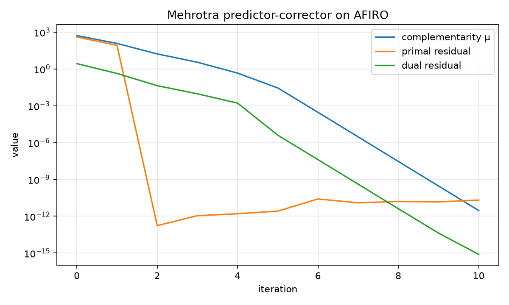

# opt-solver

[](https://github.com/IkerAbad/opt-solver/actions/workflows/ci.yml)

Linear and convex quadratic optimization from scratch, with two methods per problem and an honest comparison against HiGHS.

- **Linear programming:** two-phase primal simplex with Bland's anti-cycling rule, and Mehrotra's predictor-corrector interior-point method.
- **Convex quadratic programming:** primal active-set method for general linear constraints, and accelerated projected gradient for box constraints.
- **Input:** MPS and CPLEX LP readers.
- **Benchmark:** objective accuracy, iterations and wall-clock time against HiGHS on classic and generated instances.
- **Figures:** interior-point convergence, sensitivity to coefficients, and scaling.

## Why Python 3.12 + NumPy

The goal is to implement and compare algorithms, not to beat a production solver. Python keeps the algorithm visible, NumPy provides BLAS/LAPACK for the dense linear systems, and `highspy` puts the HiGHS reference in the same process. `pytest`, `ruff` and `mypy` cover the quality checks.

A C++/Eigen version would be faster, but it would move most of the effort into build systems and memory management, and the benchmark would still be dominated by HiGHS. The dense Python implementation is a deliberate limitation: it makes the algorithmic difference visible and the code auditable.

## Installation

```powershell
py -3.12 -m venv .venv
.\.venv\Scripts\Activate.ps1
python -m pip install --upgrade pip
pip install -e ".[dev,bench]"
```

On POSIX systems:

```bash
python3.12 -m venv .venv
source .venv/bin/activate
python -m pip install --upgrade pip
pip install -e ".[dev,bench]"
```

## Quick start

```python
import numpy as np

from opt_solver import LPProblem, solve_lp_ipm, solve_lp_simplex

problem = LPProblem(
    c=np.array([1.0, 1.0]),
    A=np.array([[1.0, 1.0]]),
    b=np.array([1.0]),
    row_sense=[">="],
    lb=np.zeros(2),
    ub=np.full(2, np.inf),
)

print(solve_lp_simplex(problem).objective)
print(solve_lp_ipm(problem).objective)
```

```python
from opt_solver import QPProblem, solve_qp_active_set

qp = QPProblem(
    Q=np.eye(2),
    c=np.array([-2.0, 1.0]),
    A=np.zeros((0, 2)),
    b=np.zeros(0),
    lb=np.zeros(2),
    ub=np.ones(2),
)

print(solve_qp_active_set(qp).x)
```

```python
from opt_solver import read_mps, solve_lp_simplex

problem = read_mps("data/classic/afiro.mps")
solution = solve_lp_simplex(problem)
print(solution.objective, solution.x)
```

## Methods

### Standard form

Every LP is converted to

```
minimize    cᵀ x
subject to  A x = b
            x >= 0
```

with `b >= 0`. Free variables are split into positive and negative parts, finite lower bounds are shifted, finite upper bounds become extra rows, and inequalities receive slack or surplus variables. The transformation stores `x_original = T x_standard + d`, so the solution is recovered without approximation. Phase I detects infeasibility. Phase II detects unboundedness when the entering column has no positive entry.

### Two-phase simplex with Bland's rule

Phase I adds one artificial variable per row and minimizes their sum. If the phase-I optimum is positive, the original problem is infeasible. Otherwise the artificial variables are pivoted out and phase II optimizes the real objective.

The entering variable is the smallest index with a negative reduced cost. On a ratio tie, the leaving variable is the one with the smallest basic index. This is Bland's rule, which rules out cycling and guarantees finite termination (Bland, 1977). The implementation uses a dense tableau and refactorizes the basis every 50 pivots to limit numerical drift. Bland's rule is robust but can be slow: its worst-case behaviour is exponential in the number of variables (Klee and Minty, 1972).

### Mehrotra predictor-corrector interior point

The solver maintains positive primal and dual iterates `x`, `s` and a dual vector `y`, and solves the perturbed KKT system

```
A x = b
Aᵀ y + s = c
x_i s_i = μ
```

Each iteration forms `D = X S⁻¹`, solves `(A D Aᵀ) dy = rhs`, and computes the primal and dual directions. The predictor uses `r_cs = x ⊙ s`. The corrector adds the second-order term `dx ⊙ ds` and uses the adaptive centring parameter `σ = (μ_aff / μ)³` (Mehrotra, 1992). A fraction-to-boundary rule keeps `x` and `s` positive. The method stops when the primal residual, the dual residual and `μ` are below `1e-10`.

The implementation is intended for feasible and bounded standard-form problems. Infeasibility and unboundedness are classified by the simplex solver.

### Convex QP: active set

The problem is

```
minimize    0.5 xᵀ Q x + cᵀ x
subject to  A x <= b
            lb <= x <= ub
```

A feasible starting point is obtained by solving a phase-I linear program with the simplex method. At each iteration the method solves the equality-constrained KKT system on the current working set. If the step is zero, it checks the multipliers and releases the constraint with the most negative multiplier. Otherwise it computes the first blocking constraint and adds it to the working set. The method terminates at a KKT point of the convex QP.

### Convex QP: projected gradient

For box constraints, the projection is exact:

```
x ← clip(y - (1/L) ∇f(y), lb, ub)
```

where `L = ||Q||₂`. The implementation uses FISTA (Beck and Teboulle, 2009) with adaptive restart and stops when the projected-gradient mapping is below tolerance. General linear rows are rejected: use the active-set method for those.

### MPS and LP readers

The MPS reader supports `NAME`, `OBJSENSE`, `OBJNAME`, `ROWS`, `COLUMNS`, `RHS`, `RANGES`, `BOUNDS` and `ENDATA`. The LP reader supports `Minimize`/`Maximize`, `Subject To`, `Bounds` and `End`. Objective constants are preserved. Integer, binary and semi-continuous variables are rejected because they are outside the project scope. The MPS reader handles free-format files and the common fixed-format layout, but not SOS, QMATRIX or indicator sections.

## Benchmark against HiGHS

Setup:

- HiGHS 1.16.0 through `highspy`, presolve disabled, primal/dual feasibility tolerances `1e-10`, IPM optimality tolerance `1e-10`.
- Our LP tolerance is `1e-10`. The QP tolerance is `1e-9`.
- Acceptance criterion: absolute difference in the optimal objective value at most `1e-8`.
- Single run per solver, measuring only the solver call. Times are indicative.
- Machine: Windows 11, Ryzen 9 5900X, Python 3.12.10, NumPy 2.5.5.

All 36 runs in [`results/benchmark.md`](results/benchmark.md) satisfy the criterion. The largest absolute gap is `1.16e-9`. Selected results:

| Problem | Kind | Solver | Objective | Iterations | Time (s) | Gap |
|---|---|---|---:|---:|---:|---:|
| beale | LP | simplex | -0.05 | 6 | 0.000737 | 0.00e+00 |
| beale | LP | ipm | -0.04999999993 | 8 | 0.001520 | 6.52e-11 |
| AFIRO | LP | simplex | -464.7531429 | 51 | 0.003209 | 2.27e-13 |
| AFIRO | LP | ipm | -464.7531429 | 10 | 0.001904 | 8.16e-11 |
| gen_box_n40_m20_s40 | LP | simplex | -31.34596605 | 421 | 0.055812 | 1.78e-14 |
| gen_box_n40_m20_s40 | LP | ipm | -31.34596605 | 11 | 0.003272 | 1.79e-10 |
| gen_box_n80_m40_s80 | LP | simplex | -48.99257995 | 2448 | 4.193211 | 7.11e-15 |
| gen_box_n80_m40_s80 | LP | ipm | -48.99257995 | 12 | 0.804348 | 1.14e-09 |
| gen_eq_n80_m40_s1080 | LP | simplex | 96.63270498 | 407 | 0.045110 | 2.70e-12 |
| gen_eq_n80_m40_s1080 | LP | ipm | 96.63270498 | 10 | 0.002798 | 6.70e-10 |
| qp_box_n40_s40 | QP | active_set | -1824.453047 | 74 | 0.047585 | 3.70e-10 |
| qp_box_n40_s40 | QP | projected_gradient | -1824.453047 | 89 | 0.002377 | 6.82e-13 |
| qp_gen_n40_m20_s2040 | QP | active_set | -1467.369297 | 101 | 0.914591 | 1.18e-11 |

The full table, including every generated size and the classic instances, is in [`results/benchmark.md`](results/benchmark.md). The raw data is in [`results/benchmark.csv`](results/benchmark.csv).

### Figures



The interior-point residuals and complementarity on AFIRO. After the least-squares initialization, the method converges in 10 iterations.


Sensitivity of the optimal solution and value to objective coefficients. The LP solution jumps between vertices. The box QP solution saturates at a bound and then moves linearly.


Scaling on generated box LPs with `m = n/2`. Simplex iterations grow quickly, while the interior-point iteration count stays between 9 and 14. At `n = 160` the Bland simplex reaches the 10000-iteration limit while the interior point converges in 14 iterations.

## Why the interior-point method wins on large problems

The simplex method moves from vertex to vertex. Each pivot is cheap, but the number of pivots can grow exponentially with the number of variables. Klee and Minty built a family of polytopes where the simplex method visits every vertex. Bland's rule prevents cycling, but it does not remove the worst-case behaviour. In the generated box LPs the simplex needed 81, 421, 2448 and 10000 (the limit) iterations for `n = 20, 40, 80, 160`.

The interior-point method follows the central path instead of the vertices. Each iteration solves one Newton system, and the iteration count is small and stable: 9, 11, 12 and 14 iterations for the same instances. The cost per iteration is dominated by the linear system `A D Aᵀ`. On large sparse problems this system is solved with a sparse Cholesky factorization, so the total work grows polynomially with the problem size. The theoretical complexity is polynomial (Karmarkar, 1984; Mehrotra, 1992).

On the generated box LPs the interior-point method is already faster at `n = 20` (0.0019 s against 0.0071 s), and the gap widens with `n`. At `n = 80` it is about five times faster (0.80 s against 4.19 s). At `n = 160`, the Bland simplex hits the iteration limit after about 94 s while the interior point converges in 5.75 s.

This is not a claim that the Python code beats HiGHS. HiGHS is a highly optimized C++ solver with sparse linear algebra. The comparison is against a dense NumPy implementation. On small classic problems the simplex is often faster because each pivot is cheap and the interior-point linear algebra overhead dominates. The point of the benchmark is the scaling, not a speed record.

## Tests and CI

```bash
pytest -q
ruff check .
mypy src
python scripts/run_benchmark.py --quick
python scripts/make_plots.py
```

The test suite contains 40 tests. `tests/test_acceptance.py` checks the `1e-8` objective criterion on the shipped set of classic and generated problems. `tests/test_infeasible_unbounded.py` checks that an infeasible instance and an unbounded instance are classified correctly.

The CI workflow runs lint, type checking and the full test suite. A second job runs the quick benchmark and uploads the CSV and Markdown results as artifacts.

## Project layout

```
src/opt_solver/
  standard_form.py    LP to standard form
  simplex.py          two-phase simplex with Bland's rule
  interior_point.py   Mehrotra predictor-corrector
  qp.py               active set and projected gradient
  parsers.py          MPS and CPLEX LP readers
  problems.py         classic and generated instances
  benchmark.py        HiGHS wrapper and benchmark helpers
tests/                pytest suite
scripts/              benchmark and figure scripts
data/classic/         Beale, Klee-Minty, AFIRO and a small MPS example
docs/figures/         generated figures
results/              benchmark outputs
```

## Limitations

- No integer, binary or semi-continuous variables. The parsers reject them instead of silently relaxing them.
- No non-convex QP. `QPProblem` checks that `Q` is positive semidefinite.
- No GUI.
- Dense linear algebra only. The code does not use sparse matrices or sparse factorizations.
- The interior-point solver assumes a feasible, bounded standard-form problem. Use the simplex solver to classify infeasible or unbounded instances.
- MPS support covers the common sections, not SOS, QMATRIX or indicator constraints.
- Timing is a single run per solver. The numbers are indicative, not a statistically controlled benchmark.

## License

MIT. Copyright (c) 2026 Iker Abad. See [`LICENSE`](LICENSE).
